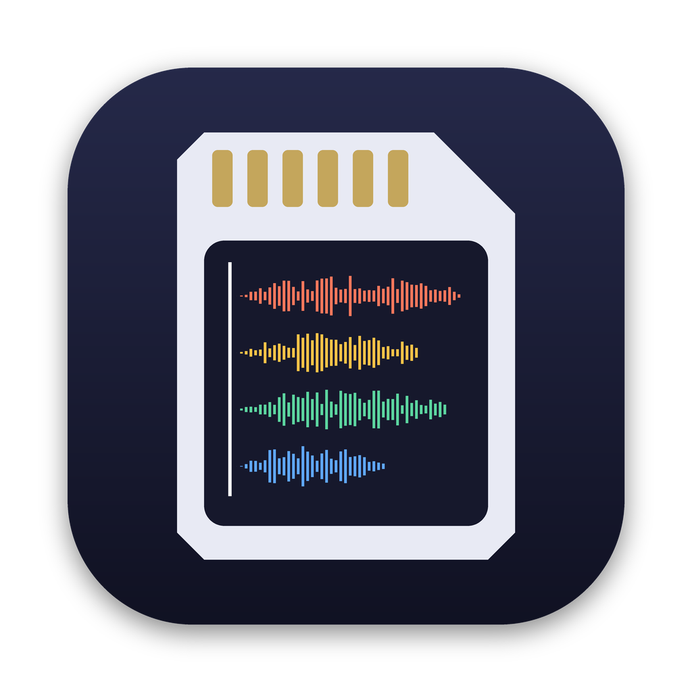

<p align="center"></p>

# DP32Export

> **Use at your own risk. Back up your cards first.** DP32Export is free software
> provided as is, without warranty of any kind, and the author accepts no liability
> for lost, damaged or incorrect recordings. It only ever reads the card, but copy
> the whole card somewhere safe before you use it, and listen to your exports
> before deleting anything. Not affiliated with or endorsed by TEAC or Tascam.

Exports songs from a Tascam DP-32SD card (or a song folder copied to the Mac) as
time-aligned mono WAV stems, without running the unit's Audio Depot export. The
card is only ever read.

Each song becomes a new folder of `{song}_TRK01.WAV`, `{song}_TRK02.WAV` … that all
start at time zero, plus the stereo master `{song}.WAV`, the previous master
`{song}_z.WAV` when present, and `Export Report.txt`.

## Download

Get **`DP32Export-<version>.dmg`** from
[Releases](https://github.com/koostix/DP32Export/releases), open it and drag
**DP32 Export** to Applications. Apple Silicon and Intel, macOS 13 or later. The DMG
also holds `Read Me First.txt` (install, use, and the disclaimer), the license and
the `dp32export` command-line tool.

The app is ad-hoc signed, not notarized. Open it once, then go to
**System Settings → Privacy & Security** and click **Open Anyway**.

## Build from source

```sh
sh scripts/build-and-open.sh      # builds, ad-hoc signs build/DP32 Export.app, opens it
sh scripts/package.sh --universal # DMG + zip for Apple Silicon and Intel (needs Xcode)
swift test                        # parser, refusals, fade vectors, end-to-end render
sh scripts/compare-hardware.sh <folder>   # needs a song folder plus the unit's own _TRKnn.WAV export of it
```

Needs Xcode or the Swift toolchain (Swift 5.9+), macOS 13+. Pushing a `v*` tag, or
running the Release workflow by hand with a version, builds the DMG and publishes a
GitHub release.

The first time the app reads the card or writes to the Desktop, macOS asks for
permission. Allow it.

## App

- Finds a mounted DP-32SD on launch and whenever a volume mounts or unmounts.
- **Open Folder…** adds a song folder, a folder of songs, or a card.
- Per song: format, length, tracks with audio, and Ready or the reason it cannot
  be exported.
- **Export All** / **Export Selected**, with progress, Cancel, and **Reveal in Finder**.
- Destination defaults to `~/Desktop/Depot Lift Exports/` and is remembered. A song
  is never written into an existing folder: `{song} 2`, `{song} 3` …
- **Pad every stem to the song length** option (remembered).

## CLI

```sh
build/dp32export list [<card | MUSIC | song folder | folder of songs>]
build/dp32export export [<path>] [--song NAME]... [--out FOLDER] [--pad]
build/dp32export compare <exported folder> <hardware folder> [--ignore-head FILE=N] [--max-differences N]
```

## Layout

- `Sources/DP32Core` — the library: edit-list parser, song planning and refusals,
  edge-fade arithmetic, streaming renderer, exporter, report. No UI imports.
- `Sources/dp32export` — the CLI.
- `Sources/DP32ExportApp` — the SwiftUI app.
- `Tests/DP32CoreTests` — synthetic `edltable.sys` builder, refusal tests, fade
  vectors read from the hardware export, end-to-end renders.
- `scripts/` — build, package (DMG), and hardware comparison.
- `Resources/` — the app icon and the end-user `Read Me First.txt` that goes in the DMG.
- `tools/reference.py` — an independent Python implementation used to work out
  and cross-check the format (`python3 tools/reference.py compare <song> <hardware folder>`).
- `docs/FORMAT.md` — the format, the fade arithmetic, and what is still unknown.

## Why a SwiftUI app plus a CLI over one library

The app is what you use day to day; the CLI makes the hardware comparison and
batch exports scriptable; both call the same `DP32Core`, so what the tests and
the comparison check is exactly what the app writes. SwiftPM keeps it a plain
folder with no Xcode project to maintain.

## Results against the hardware

Every stem has the hardware's length and header. Tracks 1, 3, 6 and 7 are
byte-identical; 7 samples out of 48,190,400 differ, each by 1 LSB, all inside
10 ms edge fades. Track 8's first 480 samples are a known hardware artifact (see
`docs/FORMAT.md`).

## Disclaimer

Provided as is, without warranty of any kind; see `LICENSE`. The author accepts no
liability for lost, damaged or incorrect recordings, cards or files. Back up your
cards before use. The DP-32SD format was worked out by reading song folders, without
documentation from Tascam; nothing in this project writes to a card. Not affiliated
with or endorsed by TEAC or Tascam; "Tascam" and "DP-32SD" are trademarks of TEAC
Corporation.

## License

MIT. See `LICENSE`.
